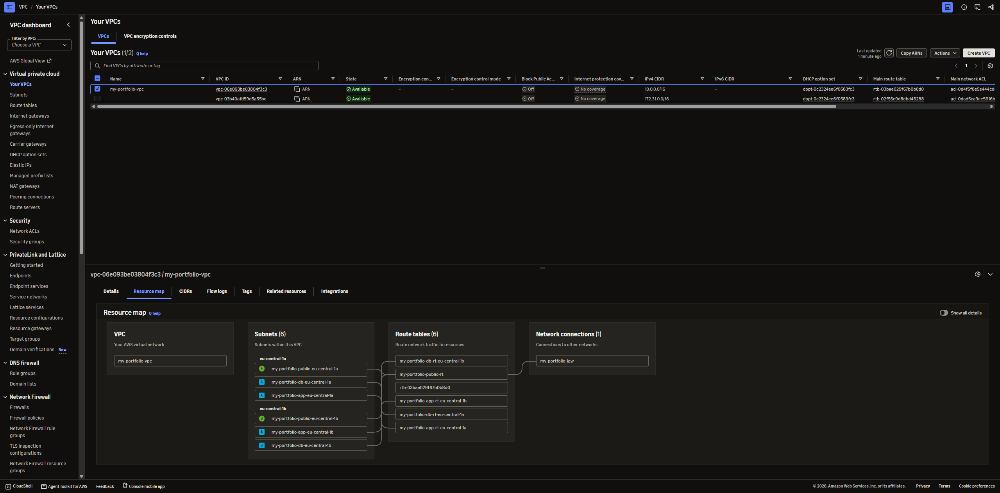
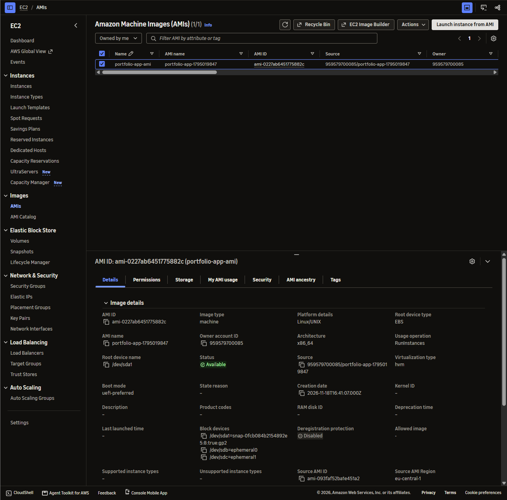
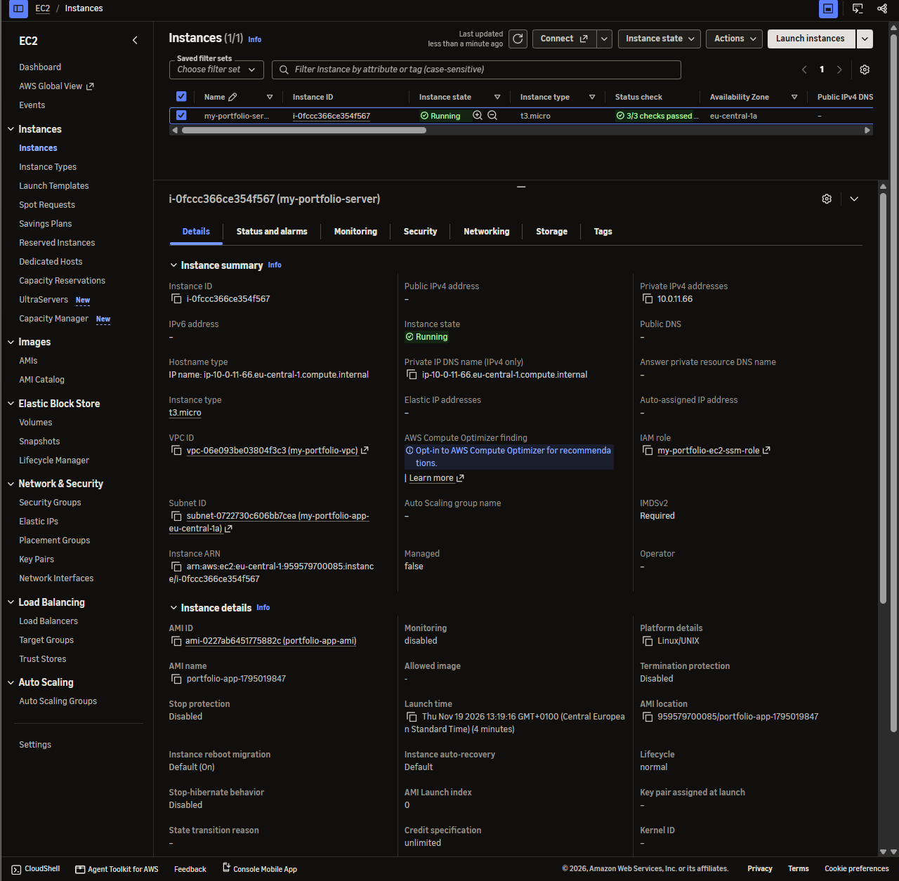
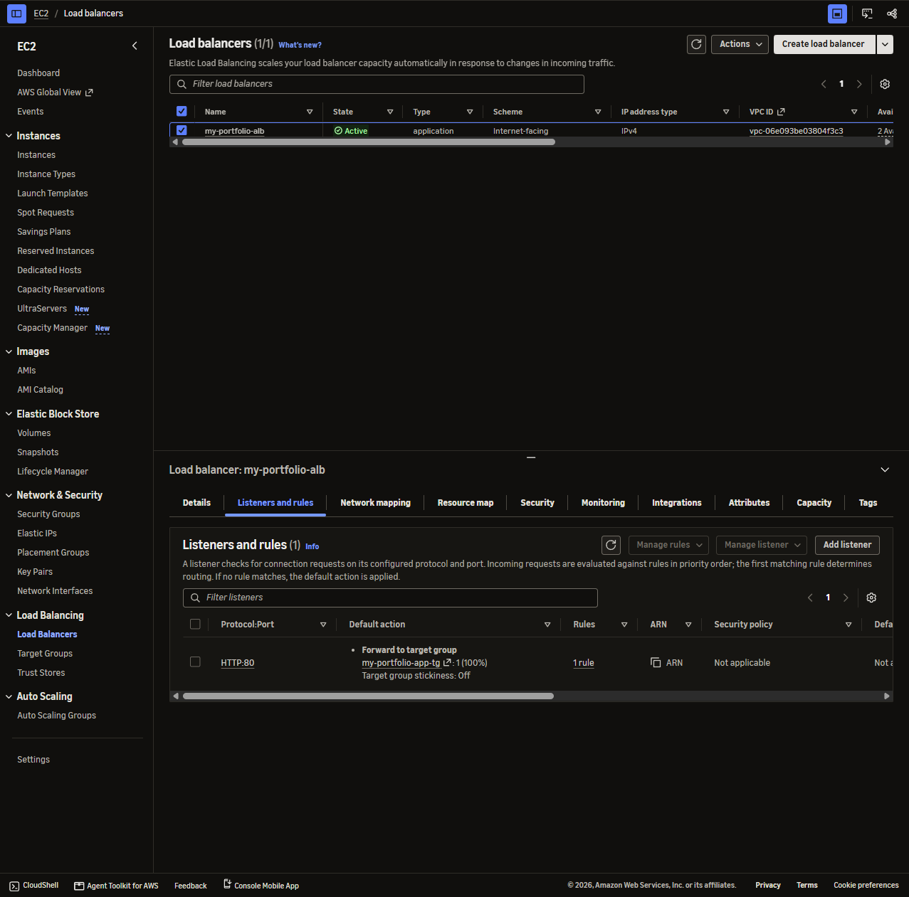
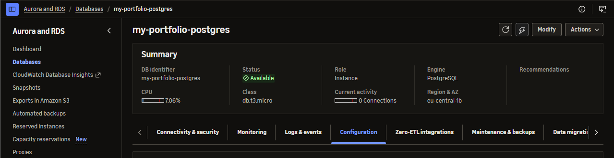
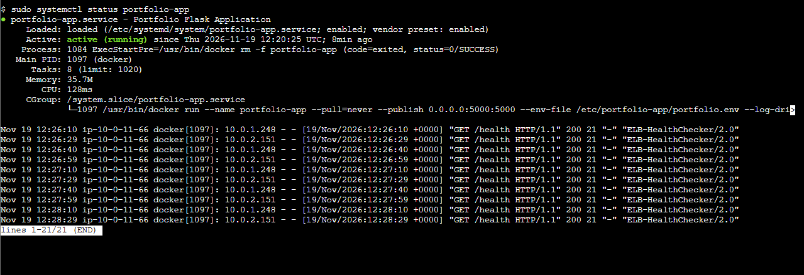
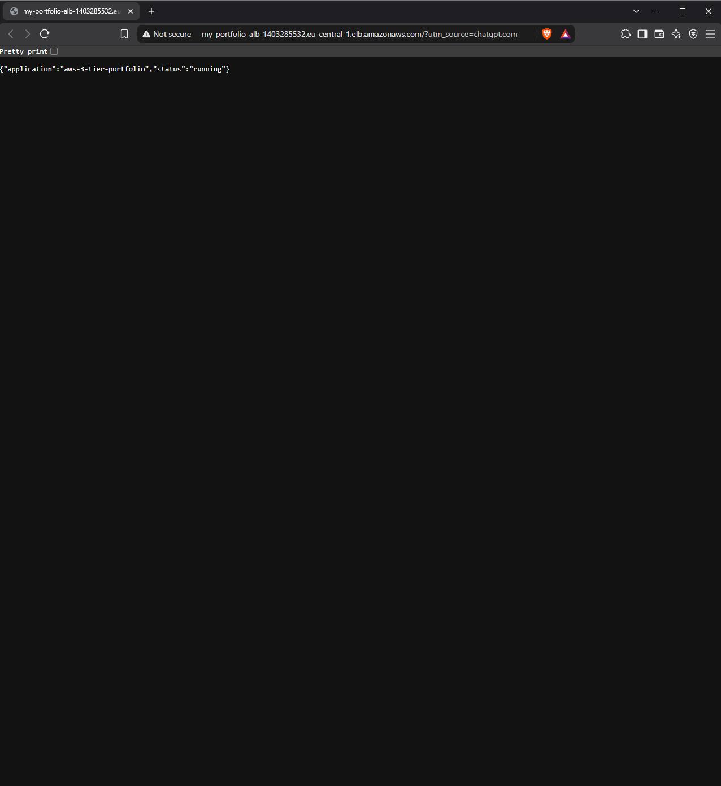
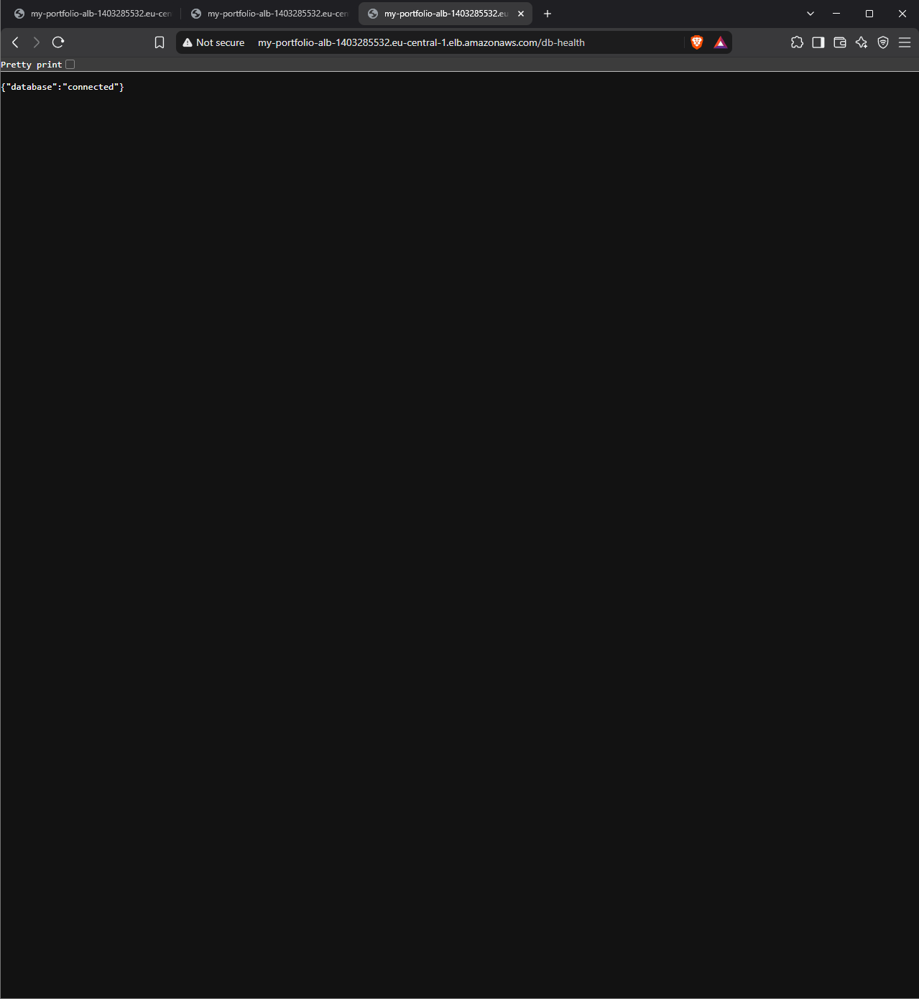

# AWS 3-Tier Web Application Infrastructure

Projekt infrastruktury chmurowej zbudowany z wykorzystaniem **Terraform**, **AWS**, **Docker**, **Packer** oraz **Python**. Demonstruje wdrożenie skonteneryzowanej aplikacji Flask na AWS w architekturze trójwarstwowej z prywatną instancją EC2 oraz prywatną bazą danych PostgreSQL.

Infrastruktura została zaprojektowana z naciskiem na izolację sieciową, uwierzytelnianie oparte na IAM, zasadę najmniejszych uprawnień (*least-privilege*) oraz optymalizację kosztów.

---

## Architektura

### Przegląd warstw

| Warstwa | Usługa AWS | Opis |
| :--- | :--- | :--- |
| **Prezentacja** (*Presentation*) | Application Load Balancer | Publiczny punkt wejścia dla przychodzącego ruchu HTTP |
| **Aplikacja** (*Application*) | EC2 + Docker | Prywatna instancja EC2 uruchamiająca skonteneryzowaną aplikację Flask |
| **Baza danych** (*Database*) | Amazon RDS PostgreSQL | Prywatna baza danych PostgreSQL z uwierzytelnianiem IAM |

### Przepływ żądań (*Request Flow*)
1. Użytkownik wysyła żądanie HTTP do **Application Load Balancer**.
2. ALB przekazuje ruch do instancji **EC2** umieszczonej w podsieci prywatnej.
3. Aplikacja **Flask** przetwarza żądanie wewnątrz kontenera **Docker**.
4. Gdy wymagany jest dostęp do bazy, aplikacja łączy się z **Amazon RDS PostgreSQL** przy użyciu **IAM Database Authentication**.
5. Odpowiedź wraca przez ALB do użytkownika.

---

## Infrastruktura

### Sieć (*Networking*)
Infrastruktura wdrażana jest w regionie AWS Frankfurt (`eu-central-1`):
* Własna sieć VPC z pulą adresową `10.0.0.0/16`.
* Dwie podsieci publiczne w dwóch strefach dostępności (*Availability Zones*).
* Dwie prywatne podsieci aplikacyjne.
* Dwie prywatne podsieci bazodanowe.
* *Internet Gateway* zapewniający łączność podsieciom publicznym.
* Osobne tablice routingu (*route tables*) dla podsieci publicznych, aplikacyjnych oraz bazodanowych.
* Brak *NAT Gateway*.
* Trzy *VPC interface endpoints* zapewniające połączenie z *Systems Manager* bez użycia *NAT Gateway*:
  * `ssm`
  * `ssmmessages`
  * `ec2messages`
  * Endpointy są wdrażane w pierwszej podsieci aplikacyjnej.



### Warstwa aplikacji (*Application Layer*)
Aplikacja działa na instancji **EC2 `t3.micro`** w podsieci prywatnej.

**Stos technologiczny:**
* Ubuntu 22.04
* Docker
* Python 3.12
* Flask
* Gunicorn
* Psycopg 3

Obraz Docker jest budowany na bazie niestandardowego obrazu AMI utworzonego przez **HashiCorp Packer**. Usługa `systemd` automatycznie uruchamia kontener aplikacji po starcie instancji EC2.







### Warstwa bazy danych (*Database Layer*)
Baza danych działa na **Amazon RDS PostgreSQL**.

**Konfiguracja:**
* PostgreSQL
* `db.t3.micro`
* 20 GB pamięci `gp3`
* Włączone szyfrowanie dysku (*storage encryption*)
* Prywatne podsieci bazodanowe
* Wyłączony dostęp publiczny (*Publicly accessible: No*)
* Włączone *IAM Database Authentication*

Aplikacja łączy się z PostgreSQL za pomocą tymczasowych tokenów uwierzytelniających IAM generowanych przez AWS SDK dla Pythona (`boto3`). Poświadczenia główne (*master credentials*) RDS są zarządzane przez **AWS Secrets Manager**.



---

## Bezpieczeństwo

W projekcie zastosowano szereg dobrych praktyk bezpieczeństwa AWS:
* Instancja EC2 wdrożona bez publicznego adresu IP.
* Baza danych RDS umieszczona w prywatnych podsieciach.
* *Security groups* skonfigurowane według zasady najmniejszych uprawnień (*least-privilege*).
* ALB przyjmuje ruch HTTP na porcie `80`.
* Aplikacja przyjmuje ruch na porcie `5000` wyłącznie z *security group* przypisanej do ALB.
* PostgreSQL przyjmuje ruch na porcie `5432` wyłącznie z *security group* przypisanej do aplikacji.
* Administracja EC2 odbywa się poprzez **AWS Systems Manager Session Manager**.
* Zamiast statycznych kluczy dostępowych na EC2 wykorzystywane są role IAM.
* Połączenia aplikacja–baza korzystają z *IAM Database Authentication*.
* Na instancji EC2 wymuszono **IMDSv2**.

> **Ograniczenie bezpieczeństwa:** *Application Load Balancer* obsługuje wyłącznie ruch HTTP. Certyfikaty TLS/HTTPS oraz własna domena nie zostały skonfigurowane, ponieważ projekt koncentruje się na demonstracji infrastruktury AWS i łączności między warstwami, a nie na udostępnieniu produkcyjnego serwisu publicznego.



---

## Infrastructure as Code

**Terraform** służy do definiowania, wdrażania oraz usuwania zasobów AWS. Konfiguracja obejmuje:
* Zasoby VPC i podsieci.
* *Internet Gateway* oraz tablice routingu.
* *Security groups* i reguły sieciowe.
* *VPC interface endpoints*.
* Instancję EC2 oraz zasoby IAM.
* *Application Load Balancer* i *target group*.
* Instancję RDS PostgreSQL.

### Niestandardowy obraz AMI z Packer
**HashiCorp Packer** buduje niestandardowy obraz AMI zawierający środowisko uruchomieniowe aplikacji i konfigurację Dockera. Dzięki temu instancje EC2 startują z gotowym środowiskiem zamiast pobierać i instalować wszystkie zależności dopiero podczas rozruchu.

---

## Endpointy aplikacji

Aplikacja Flask udostępnia następujące endpointy:

| Endpoint | Opis |
| :--- | :--- |
| `/` | Główna strona aplikacji |
| `/health` | *Health check* aplikacji |
| `/db-health` | Weryfikacja połączenia z bazą danych |

ALB wykorzystuje `/health` jako endpoint *health check* dla grupy docelowej (*target group*), a `/db-health` potwierdza łączność aplikacji z bazą PostgreSQL.






---

## Optymalizacja kosztów

Projekt uwzględnia oszczędność kosztów na etapie projektowania:
* Brak *NAT Gateway*.
* Prywatne instancje łączą się z *Systems Manager* przez *VPC endpoints*.
* Zastosowano małe klasy instancji dla EC2 i RDS.
* Środowisko jest przeznaczone do celów testowych i demonstracyjnych — po zakończeniu testów można je usunąć poleceniami Terraform.

> Zasoby AWS takie jak EC2, RDS, ALB, wolumeny EBS, *VPC endpoints* czy *snapshoty* AMI mogą generować opłaty dopóki istnieją. Zawsze upewnij się, że nieużywane zasoby zostały usunięte.

---

## Wdrożenie

### Wymagania wstępne
* Konto AWS
* Skonfigurowany AWS CLI z odpowiednimi uprawnieniami
* Terraform
* HashiCorp Packer
* Docker
* Dostęp do repozytorium projektu

### 1. Zbuduj obraz AMI aplikacji
Zbuduj własny obraz AMI za pomocą Packera na podstawie szablonu z repozytorium.

### 2. Zainicjalizuj Terraform
```bash
terraform init
```

### 3. Zwaliduj konfigurację
```bash
terraform fmt -check -recursive
terraform validate
```

### 4. Przejrzyj plan wdrożenia
```bash
terraform plan
```

### 5. Wdróż infrastrukturę
Przejrzyj proponowane zmiany przed zatwierdzeniem wdrożenia:
```bash
terraform apply
```

### 6. Zainicjalizuj użytkownika aplikacyjnego w bazie danych
Po uzyskaniu statusu `Available` przez instancję RDS wykonaj skrypt `scripts/init-db.sql` korzystając z połączenia administracyjnego PostgreSQL. Skrypt tworzy użytkownika aplikacyjnego, nadaje rolę `rds_iam` i konfiguruje uprawnienia w bazie danych.

### 7. Zweryfikuj działanie aplikacji
Użyj nazwy DNS *Application Load Balancer*, aby sprawdzić działanie endpointów:
```text
http://<ALB-DNS>/
http://<ALB-DNS>/health
http://<ALB-DNS>/db-health
```

### 8. Usuń infrastrukturę
Po zakończeniu testów usuń zasoby zarządzane przez Terraform:
```bash
terraform destroy
```
Obraz AMI oraz powiązane *snapshoty* utworzone przez Packer należy usunąć osobno, jeśli nie są już potrzebne.

---

## Zademonstrowane umiejętności
* Infrastruktura chmurowa AWS
* Infrastructure as Code (Terraform)
* Tworzenie własnych obrazów AMI (Packer)
* Konteneryzacja (Docker)
* Wdrażanie aplikacji Python / Flask
* Sieci AWS VPC i architektura podsieci publicznych/prywatnych
* Konfiguracja Application Load Balancer
* Amazon RDS PostgreSQL
* Role i polityki IAM oraz IAM Database Authentication
* AWS Systems Manager i AWS Secrets Manager
* Projektowanie *security groups*
* Optymalizacja kosztów w chmurze

---

## Autor
**Jakub Lewiński**  
GitHub: `jakub-lewinski-dev`